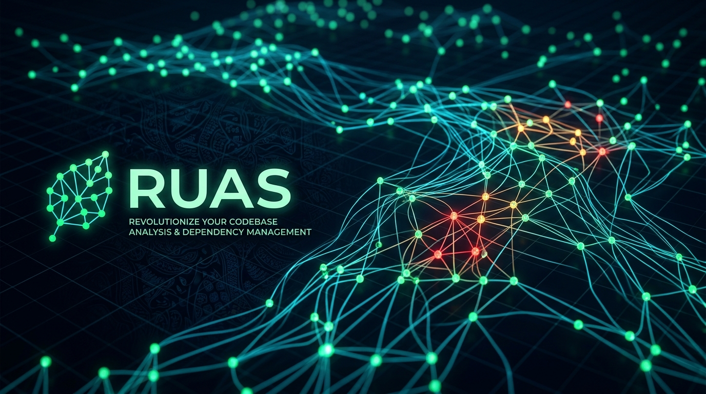
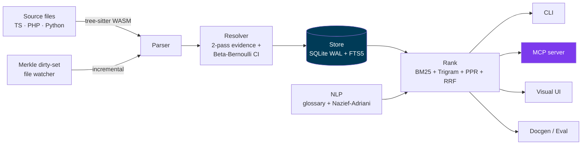
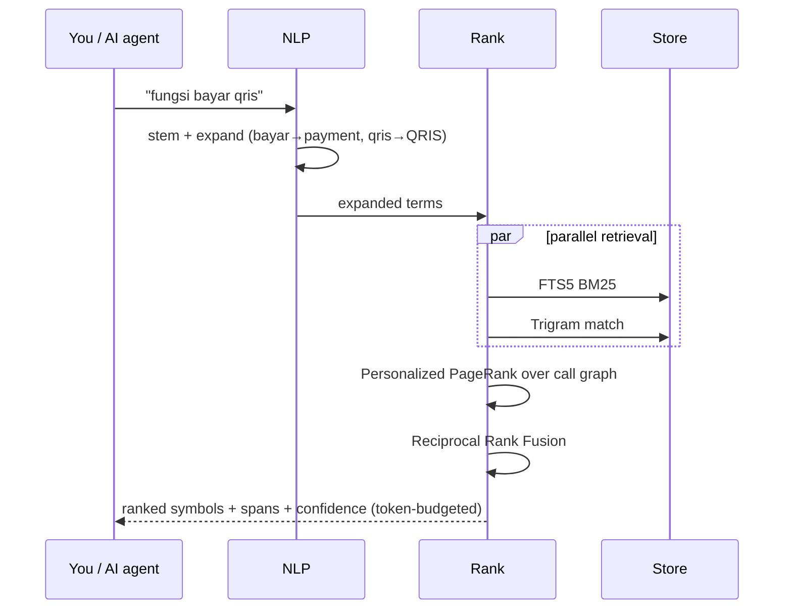
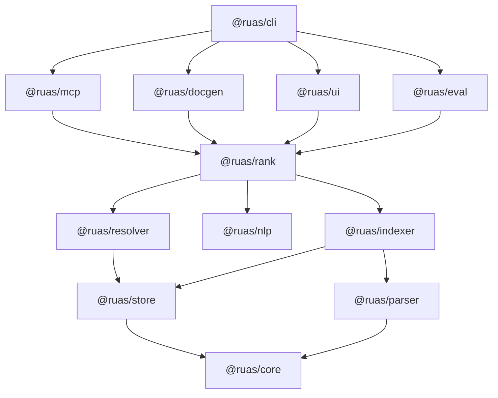
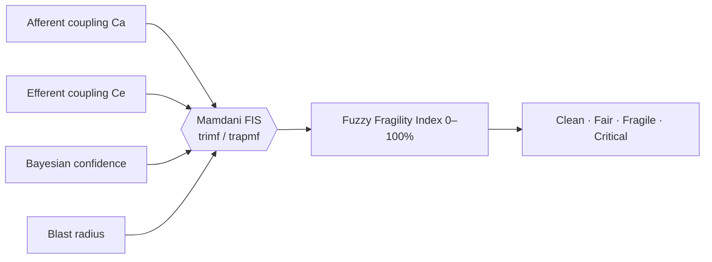
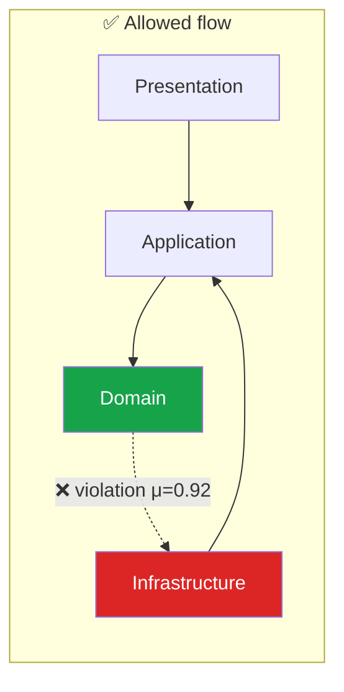
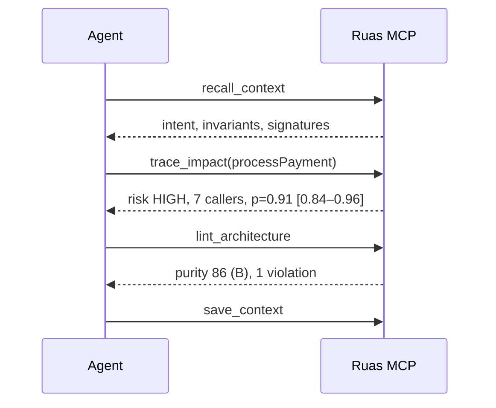
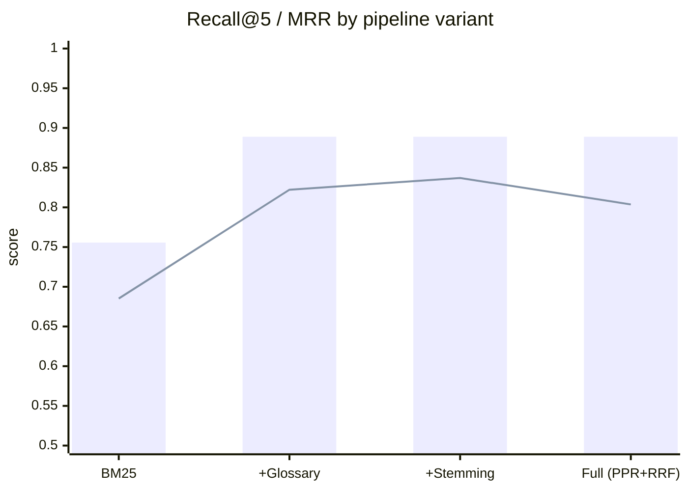
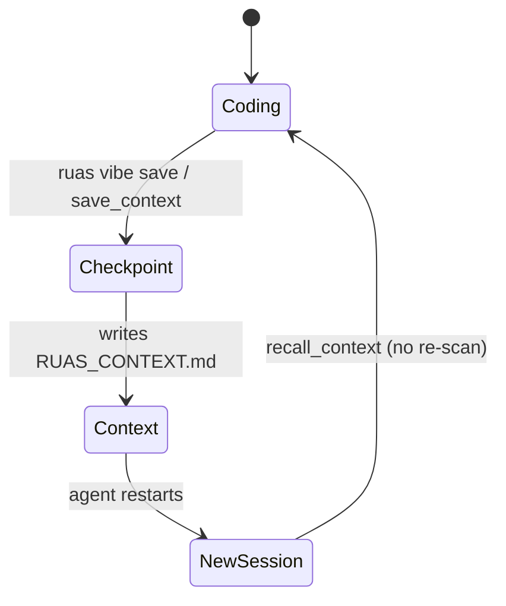

<div align="center">

<!-- Banner: generate with docs/BANNER_PROMPT.md, save as assets/banner.png -->


# 🌿 Ruas

**Offline-first code intelligence for AI agents and humans.**
Multilingual graph retrieval · Bayesian-calibrated blast radius · Fuzzy architecture linting · MCP-native.

[](https://www.npmjs.com/package/@fk0u/ruas)
[](https://github.com/OurCreativity/ruas/actions/workflows/ci.yml)
[](LICENSE)
[](https://nodejs.org)


[Quick Start](#-quick-start) · [How it works](#-how-it-works) · [CLI](#-cli-cheat-sheet) · [MCP](#-mcp-for-ai-agents) · [Benchmarks](#-benchmarks) · [Contributing](CONTRIBUTING.md)

</div>

---

## ✨ Why Ruas?

Real codebases are messy: mixed Indonesian/English identifiers, acronyms (`pQRIS`, `invGen`), hidden coupling. Generic tools hand your AI agent raw files and let it guess. Ruas gives it a **calibrated graph** instead.

| | Typical tools | **Ruas** |
|---|---|---|
| Search | English-only, embeddings via cloud API | Multilingual BM25 + trigram + glossary + Indonesian stemmer, **fully local** |
| Call paths | "Probably calls…" | Beta-Bernoulli edge confidence with **95% credible intervals** |
| Impact | Hop count | **Blast radius** with confidence decay (Dijkstra / Yen top-K) |
| Architecture | Binary pass/fail rules | **Mamdani fuzzy** violation degrees + purity grade A–F |
| AI memory | Re-scan every session | Persistent `RUAS_CONTEXT.md` "vibe memory" |
| Footprint | Vector DB + API keys | One SQLite file, runs on an 8 GB laptop |

---

## 🚀 Quick Start

```bash
npx @fk0u/ruas index .
npx @fk0u/ruas ask "fungsi bayar qris" --roast
```

<details>
<summary><b>Install globally / from source</b></summary>

```bash
npm install -g @fk0u/ruas        # or: pnpm add -g @fk0u/ruas

git clone https://github.com/OurCreativity/ruas.git
cd ruas && pnpm install && pnpm build && pnpm test
```
Requires Node ≥ 22 (uses built-in `node:sqlite`).
</details>

---

## 🧩 How it works



### Query pipeline



### Package map



---

## 🧮 The math (short version)

Edge confidence `p(e) = α / (α+β)` becomes a non-negative cost so Dijkstra finds the **most probable** path, not merely the shortest:

$$w(e) = -\ln p(e) \quad\Rightarrow\quad \min \sum w(e_i) \iff \max \prod p(e_i)$$

Fuzzy mode multiplies in a Mamdani friction factor `f(e) ∈ [1, 3.5]` so routes avoid fragile hubs.



---

## 🛠 CLI cheat sheet

| Goal | Command |
|---|---|
| Index (cold or incremental) | `ruas index .` |
| Health & stats | `ruas status .` · `ruas audit . [--fuzzy] [--json]` |
| Ask in any mix of languages | `ruas ask "calculate customer discount" --roast [--fuzzy]` |
| Blast radius | `ruas trace prosesQRIS . --depth 3 [--dijkstra]` |
| Best path A → B | `ruas path checkoutOrder calculateDiscount . [-k 3] [--fuzzy]` |
| Acronym / typo search | `ruas fuzzy pQRIS .` |
| Code smells | `ruas smell . [--json]` |
| Architecture boundaries | `ruas lint --init` → `ruas lint .` → `ruas check . --strict --json` |
| Live watcher | `ruas watch .` |
| Visual explorer (60 FPS) | `ruas ui . --port 4200` |
| Export | `ruas export . --html\|--mermaid\|--dot\|--json <file>` |
| Handover docs (cited) | `ruas docgen . --out docs/HANDOVER.md` |
| AI memory | `ruas vibe save "<intent>" -f <file> -n "<note>"` · `recall` · `sync` |
| MCP server | `ruas mcp .` |

---

## 🏗 Architecture linter



Violations carry a **continuous degree μ ∈ [0,1]**, rolled into a purity score and grade. Use `ruas check . --strict` as a CI gate (fails at purity < 80 or any critical violation).

---

## 🤖 MCP for AI agents

```json
{
  "mcpServers": {
    "ruas": {
      "command": "npx",
      "args": ["-y", "@fk0u/ruas", "mcp", "/path/to/your/project"]
    }
  }
}
```

| Tool | What the agent gets |
|---|---|
| `ask_code` | Ranked symbols, spans, signatures within a **token budget** |
| `trace_impact` | Callers/callees, edge probabilities + 95% CI, risk `LOW→CRITICAL` |
| `analyze_architecture` | Health score, cycles, dead code, instability per subsystem |
| `find_path` | Highest-confidence call path between two symbols |
| `project_overview` | Language mix, node counts, top-10 hubs |
| `lint_architecture` | Purity score + fuzzy-ranked boundary violations |
| `save_context` / `recall_context` | Persistent working memory → `RUAS_CONTEXT.md` |



---

## 🔬 Benchmarks

Hand-labeled bilingual queries over TypeScript + PHP, reproducible via `@ruas/eval`.



| Variant | R@1 | R@5 | MRR | nDCG@10 | p95 |
|---|:-:|:-:|:-:|:-:|:-:|
| BM25 only | 0.611 | 0.756 | 0.685 | 0.702 | 1.29 ms |
| + Glossary | 0.744 | 0.889 | 0.822 | 0.843 | 1.24 ms |
| + Stemming | **0.767** | **0.889** | **0.837** | **0.854** | 1.83 ms |
| Full pipeline | 0.700 | **0.889** | 0.804 | 0.830 | 8.29 ms |

**+17.6% Recall@5 over BM25** · paired Wilcoxon *p* = 0.0383 · incremental graph ≡ cold rebuild (verified).

---

## 🧠 Vibe memory (`RUAS_CONTEXT.md`)



Token-dense format: AST signatures, line spans, invariants and Bayesian edges only — no boilerplate bodies.

---

## 📚 Docs

[Roadmap](ROADMAP.md) · [Changelog](CHANGELOG.md) · [Security](SECURITY.md) · [Plan](docs/PLAN.md) · [Methodology](docs/METHODOLOGY.md) · [Handover](docs/HANDOVER.md) · [Clean-room](docs/CLEANROOM.md) · [ADRs](docs/adr) · [Third-party](THIRD_PARTY.md)

## 🤝 Contributing

PRs welcome — see [CONTRIBUTING.md](CONTRIBUTING.md). Clean-room rule: derive from papers, never copy GPL/proprietary code.

## 📄 License

MIT © 2026 Al-Ghani Desta Setyawan & Ruas Contributors.
